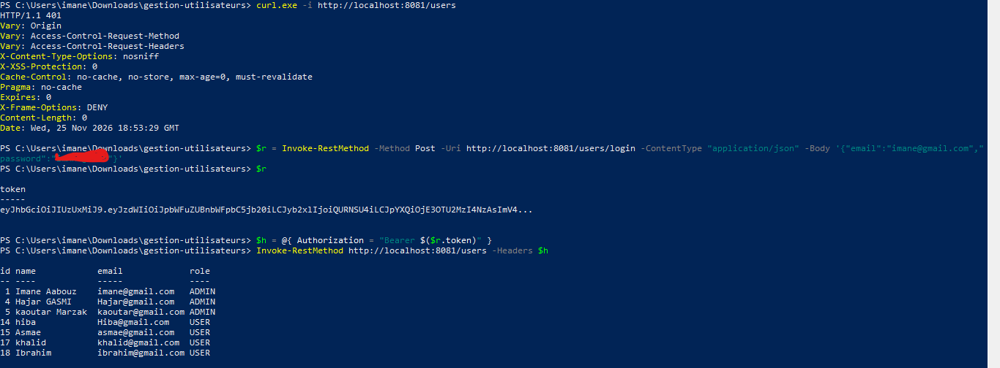
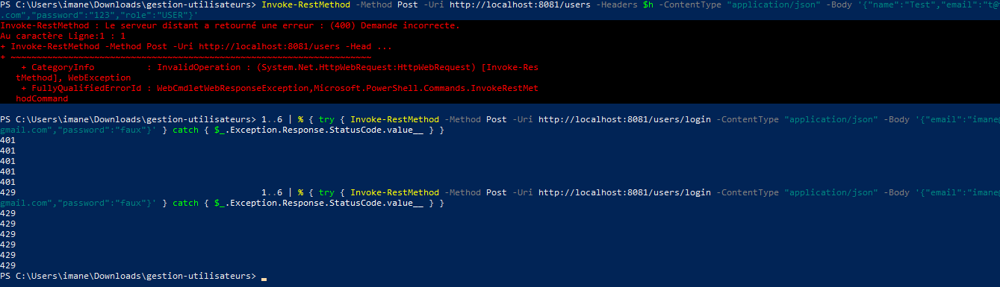
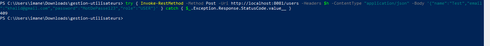

# Audit et durcissement d'une API REST Spring Boot

**Contexte.** Projet de Master Cryptographie et Sécurité de l'Information (Université Mohammed V de Rabat, 2025-2026) : API de gestion des utilisateurs (Spring Boot, Spring Security, JWT, MySQL) et interface d'administration React. Une fois la première version fonctionnelle terminée, j'ai audité mon propre code comme le ferait un pentesteur, corrigé les failles et vérifié chaque correction par des tests.

**Périmètre.** Backend `/users/**` (authentification, CRUD, recherche, pagination), configuration, gestion des secrets. Audit en boîte blanche (code source), tests avec PowerShell/`curl` et Postman.

## Synthèse des constats

| # | Faille | Gravité | Catégorie OWASP | Statut |
|---|---|---|---|---|
| 1 | Routes `/users/**` en `permitAll()` : le JWT ne protégeait rien | Critique | A01 Broken Access Control | Corrigé |
| 2 | Création de compte ouverte : n'importe qui pouvait s'attribuer `role: ADMIN` | Critique | A01 Broken Access Control | Corrigé |
| 3 | Secret JWT et mot de passe MySQL en clair dans le code | Haute | A02 Cryptographic Failures / A05 Misconfiguration | Corrigé |
| 4 | Hash BCrypt de chaque utilisateur renvoyé dans les réponses JSON | Haute | A02 / A04 Insecure Design | Corrigé |
| 5 | Aucune limitation des tentatives de connexion (brute force) | Haute | A07 Identification and Authentication Failures | Corrigé |
| 6 | Login raté renvoyé en `200` avec corps `null` | Moyenne | A07 | Corrigé |
| 7 | Aucune validation des entrées (email, rôle, longueur du mot de passe) | Moyenne | A03 Injection / A04 | Corrigé |
| 8 | Tri sur un champ choisi par le client, pagination non bornée | Moyenne | A03 / A04 | Corrigé |
| 9 | SQL et détails d'erreur dans les logs et réponses | Faible | A05 | Corrigé |
| 10 | Rôle figé dans le token : un compte supprimé garde son accès | Moyenne | A01 | Corrigé (rôle relu en base) |

## Détail des principales failles

### 1. Contrôle d'accès cassé : le JWT ne protégeait rien
**Constat.** La configuration autorisait publiquement `GET`, `POST`, `PUT` et `DELETE` sur `/users/**`. Le filtre JWT existait, mais aucune règle ne l'imposait.
**Impact.** Lecture, modification et suppression de tous les comptes sans authentification.
**Correction.** Seul `POST /users/login` est public ; `/users/**` exige `hasRole("ADMIN")` ; tout le reste est refusé (`denyAll`).
**Preuve.** `curl.exe -i http://localhost:8081/users` répond `401` sans token ; avec un token admin, la liste est renvoyée.

### 2. Escalade de privilèges
**Constat.** Le rôle était fourni par le client à la création du compte.
**Correction.** Création réservée aux administrateurs, rôle validé (`ADMIN|USER`), identifiant jamais imposé par le client.

### 3. Secrets dans le code source
**Constat.** Clé de signature JWT (`HS256`) et mot de passe de la base écrits dans les sources, donc dans le dépôt Git.
**Correction.** Variables d'environnement `JWT_SECRET` et `DB_PASSWORD`. L'application refuse de démarrer si le secret fait moins de 32 caractères. `.env` est exclu par `.gitignore`.

### 4. Exposition des hashs de mots de passe
**Constat.** L'entité `User` était sérialisée telle quelle : chaque réponse contenait le hash BCrypt.
**Correction.** `@JsonProperty(access = WRITE_ONLY)` : le mot de passe est accepté en entrée, jamais renvoyé.

### 5. Brute force
**Constat.** Nombre de tentatives de connexion illimité.
**Correction.** Blocage de 15 minutes après 5 échecs par adresse email (HTTP `429`), compteur remis à zéro après un succès.
**Preuve.** Six mauvaises connexions : `401` ×5, puis `429` ; les tentatives suivantes restent en `429`.

### 6. Un bug introduit par ma propre correction
En testant, le contrôle de la validation (mot de passe de 3 caractères) renvoyait `401` au lieu de `400`. Cause : Spring redirige chaque erreur vers `/error`, que ma règle `denyAll` bloquait. Conséquence réelle : une erreur « email déjà utilisé » (`409`) aurait déconnecté l'administrateur, et le blocage anti brute-force aurait répondu `401` au lieu de `429`. Correction : autoriser `/error` sans ouvrir aucune route métier.
**Leçon :** une règle « tout refuser par défaut » doit être testée sur les chemins d'erreur, pas seulement sur les cas nominaux.

## Vérification

| Test | Résultat attendu | Obtenu |
|---|---|---|
| `GET /users` sans token | 401 | 401 |
| Login valide puis `GET /users` | liste sans champ `password` | conforme |
| `POST /users` avec mot de passe de 3 caractères | 400 | 400 |
| 6 connexions avec mauvais mot de passe | 401 ×5 puis 429 | conforme |
| `POST /users` avec un email déjà utilisé | 409 | 409 |

Tests unitaires JWT (token valide, expiré, falsifié, signé par une autre clé, secret trop court) : `./mvnw test`.

### Preuves

**Accès refusé sans token (401), puis liste des utilisateurs avec token, sans champ `password`**

**Validation des entrées (400) et anti brute-force (401 ×5, puis 429)**

**Email déjà utilisé (409) : l'erreur ne déconnecte plus l'administrateur**

## Risques résiduels et pistes d'amélioration
- Token stocké dans `localStorage` (exposé en cas de XSS) : préférer un cookie `HttpOnly` + `SameSite` et une politique CSP.
- Compteur anti brute-force en mémoire, non partagé entre instances : Redis en production.
- Pas de refresh token ni de révocation de token.
- HTTPS non configuré en local, obligatoire en production.
- `ddl-auto=update` à remplacer par des migrations (Flyway).
- Audit des dépendances à poursuivre (`mvn dependency-check`, `npm audit`).
